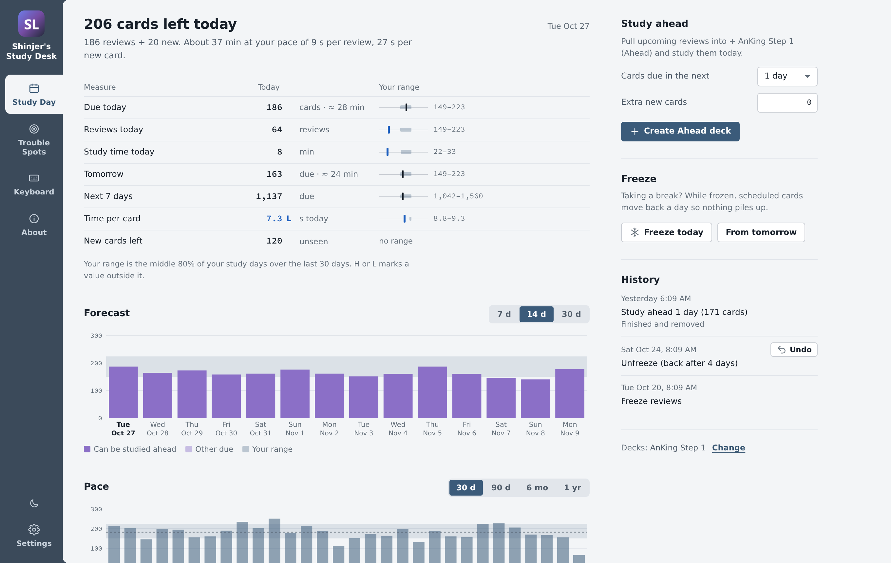
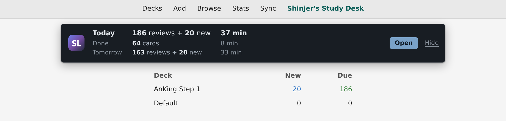
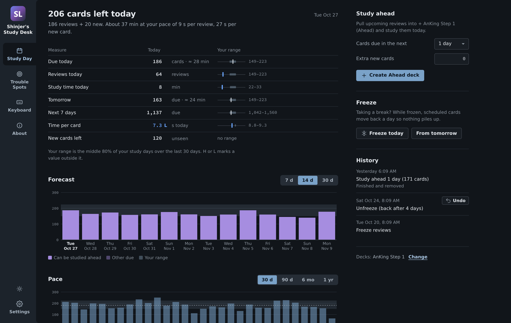
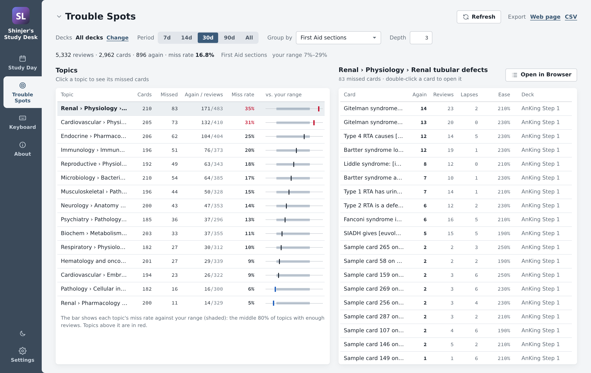
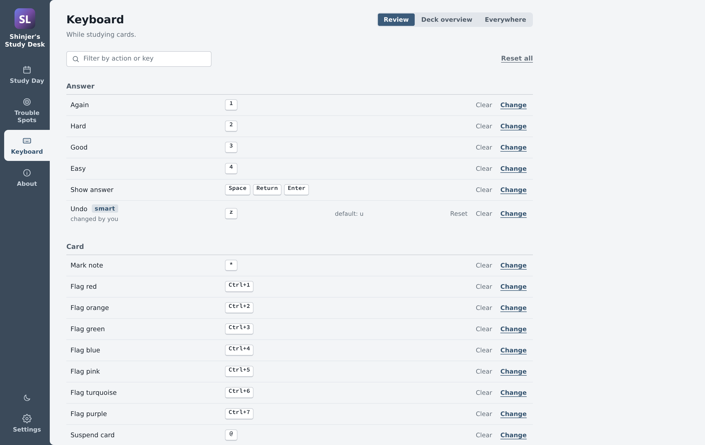
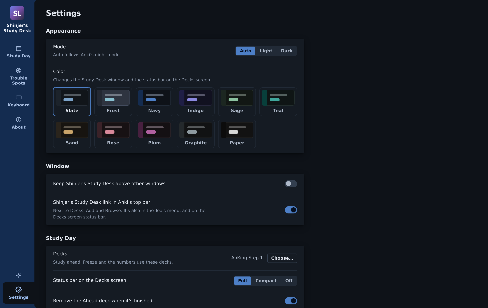

# Shinjer's Study Desk

An Anki add-on that puts your study day, the topics you miss most, and your keyboard shortcuts
in one window. Built for Step 1 students using AnKing-style decks, and it works with any deck.



## Install

You need **Anki 24.11 or newer** on Windows, macOS or Linux.

**From AnkiWeb (easiest):** in Anki, go to **Tools › Add-ons › Get Add-ons…**, enter the code
**`ANKIWEB_CODE`** and restart Anki.

**From GitHub:** download `shinjers_study_desk.ankiaddon` from the
[latest release](https://github.com/shinjer-li/shinjers-anki-study-desk/releases/latest) and
double-click it, or use **Tools › Add-ons › Install from file…**. Then restart Anki.

Updates come through **Tools › Add-ons › Check for Updates** if you installed from AnkiWeb.

> Using **Study Day Control**, **Trouble Spots** or **Keybind Remapper**? Disable them (don't
> delete them yet) before installing. Your settings are copied over once. See
> [Moving over from the old add-ons](shinjers_study_desk/README.md#moving-over-from-the-old-add-ons).

## Opening it

- The **Shinjer's Study Desk** link in Anki's top bar, next to Decks, Add and Browse.
- The status bar on the **Decks** screen. Click the logo or **Open**.
- **Tools › Shinjer's Study Desk…**



## What's inside

### Study Day

Today's reviews and new cards next to your usual range, flagged **H** or **L** when they're
outside it. **Study ahead** pulls upcoming reviews into a temporary deck when you have time to
spare. **Freeze** pauses reviews for a break so they don't pile up. There's also a forecast,
your pace, and a history where every action can be undone. It stays in step with Anki's own
Edit › Undo.



### Trouble Spots

Topics ranked by how often you miss them, grouped by First Aid section, Pathoma chapter,
Boards & Beyond or Sketchy video, organ system, subdeck or any tag you type. Click a topic to
see its cards, open them in the Browser, or export a study sheet or CSV. It only reads your
collection and never changes your cards.



### Keyboard

Every shortcut on the review screen, the deck overview and everywhere else in Anki. Click an
action and press a key. If the key is taken, swap it, give the old action a spare key, or
unbind it. **Smart undo** flips back to the question instead of undoing a review.



### Settings and About

Light, dark or Auto (follows Anki's night mode), eleven color themes, the window, the top-bar
link, and each tab's own options. **Tools › Add-ons › Shinjer's Study Desk › Config** opens
this tab. The About tab has a quick start and links back here.



## Quick start

1. **Choose your decks** in Settings. Study Day counts only the decks you pick.
2. **Check Study Day before you review.** See what's left and how long it should take.
3. **Look at Trouble Spots once a week.** First Aid sections over the last 30 days is a good
   start. The topics at the top are the ones to reread or rewatch.

## Good to know

- **Your data stays on your computer.** The add-on never connects to the internet.
- **Study Day and Trouble Spots settings** are saved in your collection, so they sync.
  Look, window and keyboard settings apply to every profile on this computer.
- **Trouble Spots works best with AnKing-style tags** (`#AK_Step1_v12::#FirstAid::…`), but can
  group by subdeck or any tag.

## Problems and ideas

[Open an issue](https://github.com/shinjer-li/shinjers-anki-study-desk/issues/new/choose).
Include your Anki version (Help › About) and, if there was an error window, its text.

## For developers

The add-on lives in [`shinjers_study_desk/`](shinjers_study_desk). Its
[README](shinjers_study_desk/README.md) explains how the code is laid out, how to add a tab,
and how to run the tests.

```
python build.py                 # dist/shinjers_study_desk.ankiaddon
```

The screenshots are drawn from the add-on's real page with made-up data:

```
python tools/sample_data.py     # needs the `anki` package; writes tools/out/sample.json
python tools/screenshots.py     # needs Playwright + Chromium; writes docs/screenshots/
```

To try local changes, link or copy `shinjers_study_desk/` into Anki's add-ons folder
(**Tools › Add-ons › View Files**) and restart Anki.

## License

[MIT](LICENSE) © 2026 Shinjer Li
